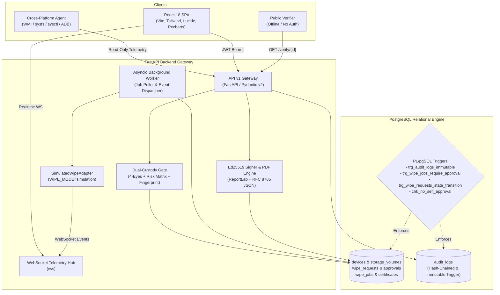

# SecureWipe: Secure Data Wiping & Certified IT Asset Recycling Platform

[](docs/SECURITY.md)
[](docs/ARCHITECTURE.md)
[](LICENSE)
[](backend/tests/)

> [!IMPORTANT]
> **CRITICAL SAFETY GOVERNANCE: SIMULATION ONLY**
> SecureWipe is an educational, testing, and compliance demonstration platform. Under **NO CIRCUMSTANCES** does any code within this repository format, wipe, partition, trim, or overwrite physical storage hardware. All wiping routes through an isolated `SimulatedWipeAdapter`. The backend strictly enforces `WIPE_MODE=simulation` and refuses to boot under any other value. Destructive command invocation is banned repository-wide and enforced by automated scanner tests (`test_no_destructive_commands.py`).

---

## 1. System Overview

SecureWipe is an enterprise-grade IT asset decommissioning platform engineered to manage the certified sanitization and chain-of-custody recycling of enterprise storage devices (HDDs, NVMe SSDs, SATA SSDs, Mobile UFS/eMMC, USB/SD media).

### Key Architectural Pillars
- **Strict Dual-Custody Approval Gate**: Enforces the four-eyes principle (requester can NEVER approve their own request) via API, service logic, and database CHECK constraints. High-risk requests mandate two distinct approvers.
- **NIST SP 800-88 Rev. 1 Mapping**: Resolves Clear vs. Purge methods based on underlying media physics, incorporating hidden-area sweeps (HPA/DCO/remapped sectors) and sample readback verification.
- **Append-Only Immutable Audit Trail**: PostgreSQL PL/pgSQL trigger blocks `UPDATE` and `DELETE`. Sequential SHA-256 hash chaining ensures mathematical tamper detection from genesis to head.
- **Offline-Verifiable Ed25519 Certificates**: Digital certificates canonicalized via RFC 8785 and signed with Ed25519 private keys. Emits ReportLab PDFs with embedded QR codes and diagonal simulation watermarks. Public verification endpoint operates without login.
- **Read-Only Telemetry Agent**: Cross-platform Python inspection agent collecting hardware identity and volume layouts without executing modifying operations.

---

## 2. Architecture Diagram



---

## 3. Quickstart & Installation

### Option A: Standard Docker Compose (Linux / CI / Production)
```bash
# 1. Clone repository
git clone https://github.com/organization/secure-wipe.git
cd secure-wipe

# 2. Launch database, backend API, and web interface
docker compose up -d

# 3. Seed demonstration devices and user personas
docker compose exec backend python seed.py
```

### Option B: Local Development (Windows / Native Host)
```bash
# 1. Activate Python virtual environment and install dependencies
python -m venv .venv
.\.venv\Scripts\activate
pip install -r backend/requirements.txt
pip install -e agent/

# 2. Start PostgreSQL daemon (e.g. port 5434)
& "C:\Program Files\PostgreSQL\18\bin\postgres.exe" -D "d:\seml\pgdata" -p 5434

# 3. Apply database migrations and seed data
python backend/seed.py

# 4. Start FastAPI backend
uvicorn backend.app.main:app --host 127.0.0.1 --port 8001

# 5. Start Vite frontend
cd frontend
npm install
npm run dev
```

Visit the frontend at **`http://127.0.0.1:5173`**.

---

## 4. Roles and Dashboards

The platform has exactly **three roles**, and each one signs in to its own dashboard:

| Role | Demo login | Password | Dashboard |
| :--- | :--- | :--- | :--- |
| **Admin** (asset registry) | `admin@securewipe.local` | `Admin123!` | Registers and manages every office device (manual form, browser detection, CSV import), sees certificate status per device, manages users, audit log. |
| **Operator** (device owner / user) | `operator@securewipe.local` | `Operator123!` | Picks a registered device and submits a wipe-certificate request, tracks it live (Requested → Approved → Data wiped → Certificate) and downloads the signed PDF. |
| **Approver** (certifying authority) | `approver@securewipe.local` | `Approver123!` | Reviews pending requests and approves or rejects them (rejection needs a reason the operator sees). |

### Certificate workflow

1. **Admin** adds the device to the registry.
2. **Operator** requests a certificate for it (confirms by typing the serial number). Only one open request per device.
3. **Approver** approves or rejects. A requester can never approve their own request.
4. On approval the simulated NIST SP 800-88 wipe is queued automatically, verified, and an **Ed25519-signed PDF certificate** with a verification QR code is issued.
5. The Operator (and Admin/Approver) download the PDF; anyone can verify it at `/verify`.

Screenshots of each dashboard are in [`docs/screenshots/roles`](docs/screenshots/roles).

---

## 5. Technology Stack

| Layer | Framework & Libraries | Description |
| :--- | :--- | :--- |
| **Frontend** | React 18, Vite 6, TypeScript, Tailwind CSS | Single Page Application with accessible dark/light themes. |
| **Components & Icons**| Lucide React, Radix UI primitives | Professional cybersecurity product design system. |
| **Visualizations** | Recharts | Fleet distribution, weekly sanitization trends, and turnaround time. |
| **Backend** | Python 3.12, FastAPI, Pydantic v2 | High-throughput asynchronous REST gateway and OpenAPI contract. |
| **Database** | PostgreSQL 16/18, asyncpg, SQLAlchemy 2.0 | Relational integrity, PL/pgSQL triggers, and JSONB telemetry storage. |
| **Realtime** | Native FastAPI WebSockets | Live multi-pass progress, log streaming, and approval alerts. |
| **Cryptography** | `cryptography` (Ed25519, SHA-256, Argon2id) | Mathematical non-repudiation and RFC 8785 canonical signatures. |
| **Documents** | ReportLab 4.x, `qrcode` | PDF Certificate of Sanitization with embedded verification QR code. |
| **Agent** | `psutil`, `py-cpuinfo`, read-only `adb` | Cross-platform hardware discovery (Windows, Linux, macOS, Android). |
| **Testing** | `pytest`, `pytest-asyncio`, `playwright` | 23 automated unit/integration tests and complete browser E2E flow. |

---

## 6. Documentation Directory Index

- [Architecture Specifications (`docs/ARCHITECTURE.md`)](docs/ARCHITECTURE.md): Detailed subsystem designs and data flows.
- [API Reference (`docs/API.md`)](docs/API.md): Endpoint specifications, WebSocket events, and error schemas.
- [OpenAPI 3.1 Contract (`docs/openapi.json`)](docs/openapi.json): Full machine-readable API contract.
- [Security Architecture & Threat Model (`docs/SECURITY.md`)](docs/SECURITY.md): STRIDE analysis, cryptographic proofs, and simulation guarantees.
- [Forbidden Destructive Commands (`docs/FORBIDDEN_LIST.md`)](docs/FORBIDDEN_LIST.md): Strict inventory of banned command strings.
- [Architecture Decisions Log (`docs/DECISIONS.md`)](docs/DECISIONS.md): Complete chronological record of engineering decisions.
- [5-Minute Demo Script (`docs/DEMO_SCRIPT.md`)](docs/DEMO_SCRIPT.md): Step-by-step evaluator walkthrough guide.

---

## 7. Automated Test Suites & Verification

Execute all automated verification tests:

```bash
# Run backend safety scanner, trigger tests, crypto tests, and agent fixtures
pytest -v

# Run browser End-to-End Playwright flow capturing all screenshots
python e2e/run_full_flow.py

# Verify frontend TypeScript build
cd frontend && npm run build
```
