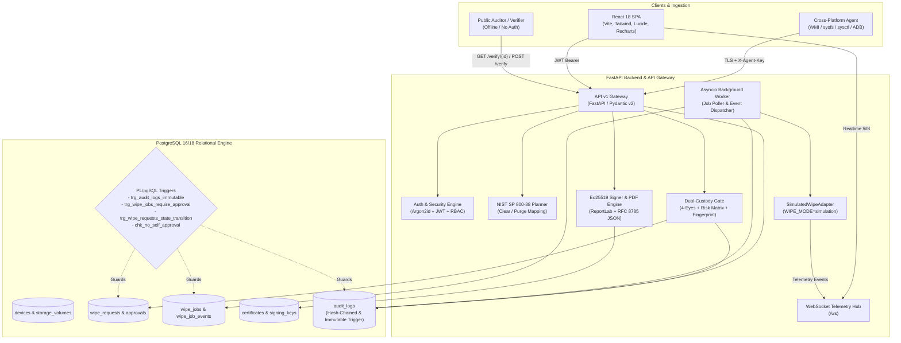

# System Architecture & Technical Specifications

The **Secure Data Wiping and Certified IT Asset Recycling Platform** (`SecureWipe`) is a production-grade, enterprise compliance system designed to manage the end-of-lifecycle sanitization and certified recycling of diverse IT storage hardware.

The platform strictly enforces the **NIST SP 800-88 Rev. 1 Guidelines for Media Sanitization**, dual-custody authorization gates, append-only immutable audit logging, and offline-verifiable Ed25519 digital certificates.

---

## 1. High-Level Architecture Diagram

---

## 2. Core Subsystems

### 2.1 Dual-Custody Approval Gate (Four-Eyes Principle)
Wiping operations carry irreversible operational risk. SecureWipe enforces three distinct defensive tiers preventing unauthorized execution:

1. **Database Level**:
   - `chk_no_self_approval`: `CHECK (approver_id <> requester_id)` on the `approvals` table.
   - `trg_wipe_jobs_require_approval`: PL/pgSQL trigger blocking `INSERT` into `wipe_jobs` unless a matching approval in status `APPROVED` exists.
   - `trg_wipe_requests_state_transition`: State machine trigger enforcing legal transition paths (`DRAFT` -> `PENDING_APPROVAL` -> `APPROVED` -> `QUEUED` -> `RUNNING` -> `VERIFYING` -> `COMPLETED`).
2. **Service Level**:
   - Request fingerprint binding: Computes `SHA-256(device_id + sorted(volume_ids) + method + serial_number)`. If the request or device properties are altered after approval, the fingerprint fails and the job refuses to start.
   - Single-use token issuance: Approval generates a 256-bit cryptographically secure random token (`raw_token`). Only its SHA-256 digest is persisted. When starting a job, `used_at` is set, blocking token replay attacks.
   - Multi-approver escalation: Low-risk requests require 1 distinct approver. High-risk requests (targeting system/boot volumes, Purge on production hardware, or batches > 5 devices) strictly mandate **two distinct approvers**.
3. **API Level**:
   - `require_roles([UserRole.APPROVER, UserRole.ADMIN])` dependency gating review operations.

---

### 2.2 NIST SP 800-88 Rev. 1 Sanitization Planner
Media sanitization techniques differ drastically based on physical storage architecture. The `WipePlanner` automatically resolves the correct standard:

| Media Type | NIST Method | Sanitization Protocol | Simulated Passes & Verification |
| :--- | :--- | :--- | :--- |
| **Magnetic HDD** | NIST CLEAR | 1-Pass Logical Overwrite (3-pass optional) | 0x00 pattern overwrite + 15% random sector readback |
| **Magnetic HDD** | NIST PURGE | ATA Secure Erase | Firmware-level drive lock + secure erase + HPA/DCO unmask |
| **SATA SSD** | NIST PURGE | ATA Sanitize / Crypto Erase | Controller crypto-key destruction + wear-level block erase |
| **NVMe SSD** | NIST PURGE | NVMe Crypto Sanitize | Namespace user data erase + cryptographic key replacement |
| **UFS / eMMC / Mobile** | NIST PURGE | Android FBE Crypto-Erase | Trusted Execution Environment (TEE) credential wipe + factory reset |
| **USB / SD Removable** | NIST CLEAR | Logical Overwrite | 1-pass pseudorandom write + FAT32/exFAT signature wipe |

Each simulated wipe cycle includes an explicit **Hidden Area Step** (Host Protected Area `HPA`, Device Configuration Overlay `DCO`, and remapped sector validation) and a **Cryptographic Verification Step**.

---

### 2.3 Immutable Hash-Chained Audit Trail
Audit trail entries cannot be updated, deleted, or backdated, even by platform database administrators:
- **Database Trigger**: `trg_audit_logs_immutable` raises an exception on any `UPDATE` or `DELETE` statement.
- **Sequential Hash Chaining**: Every log row incorporates the sequence number, UTC timestamp, actor ID, action, entity type, entity ID, JSONB details, and `prev_hash`:
  $$\text{hash}_n = \text{SHA-256}(\text{prev\_hash}_{n-1} \parallel \text{seq}_n \parallel \text{ts}_n \parallel \text{actor}_n \parallel \text{action}_n \parallel \text{entity}_n \parallel \text{details}_n)$$
- **Continuous Integrity Verifier**: `GET /api/v1/audit/verify-chain` programmatically iterates through every row from genesis ($\text{prev\_hash} = \text{"0"}\times 64$) to the current head, detecting any insertion, truncation, or payload modification.

---

### 2.4 Cryptographic Certificates & Public Verification
Upon wipe job completion, the platform generates a tamper-evident digital certificate:
1. **Canonical JSON Serialization**: Adheres to RFC 8785 (JSON Canonicalization Scheme) to eliminate whitespace and dictionary ordering ambiguities.
2. **Ed25519 Digital Signature**: The SHA-256 digest of the canonical JSON is signed using an Ed25519 private key generated in-process or read from platform key storage.
3. **Public Key Discovery**: Platform public keys are published at `/.well-known/wipe-keys` for offline verification.
4. **ReportLab PDF Generation**: Emits a compliant Certificate of Sanitization featuring:
   - Certificate Unique ID & Timestamps.
   - Sanitized Asset Specs (Category, Manufacturer, Model, Hashed Serial).
   - Sanitization Method & NIST SP 800-88 Rev. 1 Category.
   - Custody Records (Operator, Approver 1, Approver 2).
   - Embedded QR Code resolving to `/verify/{certificate_id}`.
   - Prominent diagonal `SIMULATION CERTIFICATE` watermark.

---

### 2.5 Cross-Platform Device Detection Agent
The `wipe-agent` Python package operates in **strictly read-only mode**:
- **Windows**: Queries WMI classes `Win32_ComputerSystem`, `Win32_SystemEnclosure` (chassis codes), `Win32_DiskDrive`, `Win32_EncryptableVolume` (BitLocker status check).
- **Linux**: Reads `/sys/class/dmi/id/*`, `/sys/class/power_supply/*`, `/proc/device-tree/model` (SBCs), `/sys/block/*`, and verifies LUKS via `cryptsetup status`.
- **macOS**: Parses `system_profiler SPHardwareDataType`, `sysctl hw.model`, and Apple FileVault status.
- **Android**: Interfaces through read-only `adb devices -l`, `getprop ro.product.*`, and window density metrics (`wm size`, `wm density`) where smallest width $\ge 600\text{dp}$ indicates tablet.
- **Browser-Side Fallback**: `navigator.userAgentData` with `userAgent` fallback provides client-side suggestions with explicit sandbox boundary disclaimers.

---

## 3. Technology Stack Reference

| Tier | Technology | Purpose |
| :--- | :--- | :--- |
| **Frontend Framework** | React 18, Vite 6, TypeScript | Single Page Application shell |
| **UI Components & Styling** | Tailwind CSS, Lucide React, Radix UI | Accessible dark/light mode security product interface |
| **Data Fetching & State** | Zustand, TanStack Query, React Router v6 | Auth persistence, client state, and typed routing |
| **Charts & Visualizations** | Recharts | Fleet distribution, weekly wipes, and turnaround analytics |
| **Backend Framework** | Python 3.12, FastAPI, Pydantic v2 | High-throughput asynchronous REST & WebSocket gateway |
| **Database Engine** | PostgreSQL 16/18, asyncpg, SQLAlchemy 2.0 | Transactional persistence, triggers, and JSONB storage |
| **Cryptography** | `cryptography` (Ed25519, SHA-256, Argon2id) | Signature verification, token hashing, and audit chains |
| **PDF & QR Engine** | ReportLab 4.x, `qrcode` | Certified IT asset sanitization documents |
| **Agent Telemetry** | `psutil`, `py-cpuinfo`, read-only `adb` | Cross-platform hardware and volume discovery |
| **Testing & QA** | `pytest`, `pytest-asyncio`, `playwright` | Unit, trigger, safety, and browser end-to-end testing |
