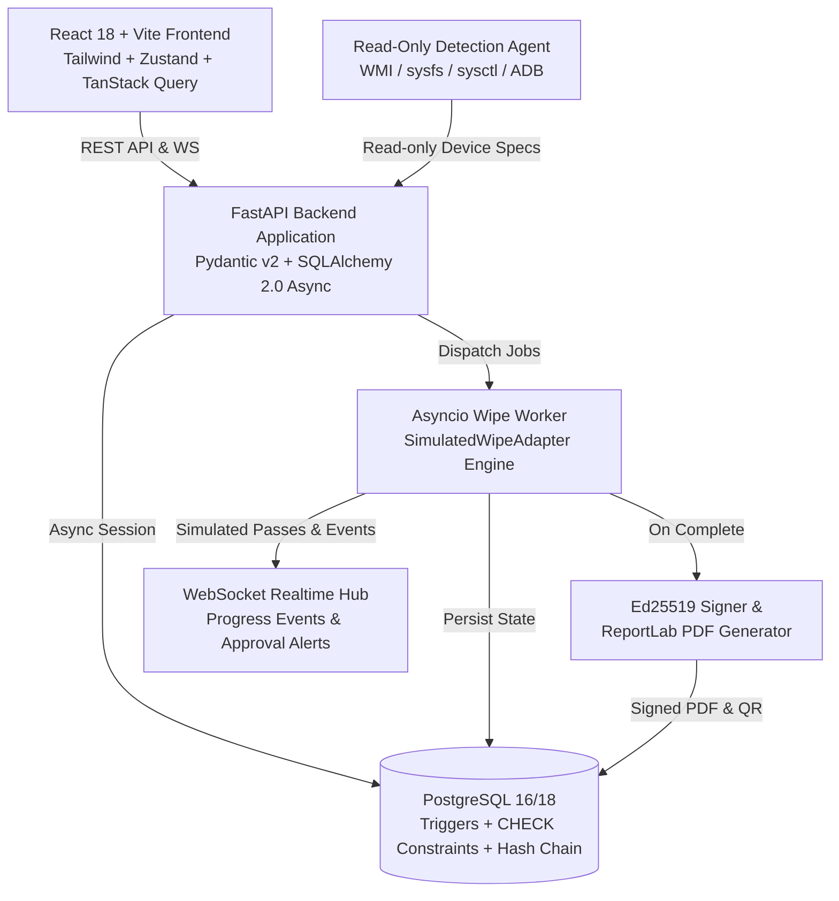

# Implementation Plan - Secure Data Wiping & Certified IT Asset Recycling Platform

A production-grade, certified IT asset recycling and NIST SP 800-88 Rev. 1 data wiping platform featuring cryptographic verification, dual-custody approval workflows, read-only device detection, hash-chained audit logging, and strict simulation-only guarantees.

## User Review Required

> [!IMPORTANT]
> **SIMULATION ONLY**: The platform strictly simulates data wiping operations via `SimulatedWipeAdapter`. No block devices or real storage volumes are ever formatted, erased, trimmed, or altered. The configuration `WIPE_MODE=simulation` is enforced, and any destructive commands are blocked and scanned via `test_no_destructive_commands.py`.

> [!NOTE]
> Four pre-seeded accounts will be available for evaluation:
> - **Operator**: `operator@securewipe.local` / `Operator123!`
> - **Approver**: `approver@securewipe.local` / `Approver123!`
> - **Admin**: `admin@securewipe.local` / `Admin123!`
> - **Auditor**: `auditor@securewipe.local` / `Auditor123!`

---

## Architecture Overview

---

## Proposed Changes & Phased Execution

### Phase 1: Environment Setup, Docs, Safety Foundation
- Create directory structure (`backend`, `agent`, `frontend`, `docs`, `e2e`).
- Create `docs/FORBIDDEN_LIST.md` and `docs/DECISIONS.md`.
- Implement `backend/tests/test_no_destructive_commands.py` safety validator.
- Set up local PostgreSQL cluster on dedicated port (5434) and configure `docker-compose.yml` and `Makefile`.
- Initialize backend Python virtual environment and dependencies (`fastapi`, `uvicorn`, `sqlalchemy[asyncio]`, `asyncpg`, `alembic`, `pydantic`, `cryptography`, `argon2-cffi`, `reportlab`, `qrcode`, `psutil`, `pytest`, `httpx`).

### Phase 2: Database Schema, Triggers, and Hash-Chained Audit Logs
- Implement SQLAlchemy 2.0 async models with UUID PKs:
  - `organizations`, `users`, `devices`, `storage_volumes`, `wipe_requests`, `approvals`, `wipe_jobs`, `wipe_job_events`, `certificates`, `signing_keys`, `agents`, `notifications`, `audit_logs`.
- Implement PostgreSQL PL/pgSQL triggers and constraints:
  - `trg_audit_logs_immutable`: blocks `UPDATE` and `DELETE` on `audit_logs`.
  - `trg_wipe_jobs_require_approval`: checks valid, approved, unexpired approval with matching `request_id` and fingerprint.
  - `chk_no_self_approval`: prevents `approver_id == requested_by`.
  - `trg_wipe_requests_state_transition`: enforces legal state machine transitions.
- Implement SHA-256 hash chaining on audit log records and `GET /api/v1/audit/verify-chain`.

### Phase 3: Core Backend Services & Wipe Simulation Engine
- `RequestStateMachine` service for DRAFT -> PENDING_APPROVAL -> APPROVED -> QUEUED -> RUNNING -> VERIFYING -> COMPLETED.
- NIST SP 800-88 Rev. 1 `WipePlanner` mapping storage types to Clear/Purge methods with hidden area checks (HPA/DCO, remapped sectors, over-provisioning).
- `WipeAdapter` ABC and `SimulatedWipeAdapter` with progress streaming, phase transitions, and seedable failure rates.
- Background worker executing queued jobs, validating single-use approval tokens, and broadcasting live WebSocket events.
- Ed25519 signing keys, canonical JSON hash, ReportLab PDF certificate generation with QR code and SIMULATION watermark.
- Public certificate verification endpoints (`GET /verify/{id}`, `POST /verify`).

### Phase 4: API Layer & OpenAPI Contract
- Authentication with Argon2id, JWT access & rotating refresh tokens, RBAC (`OPERATOR`, `APPROVER`, `ADMIN`, `AUDITOR`).
- Devices CRUD, stats, CSV import, and agent registration/heartbeat endpoints.
- Wipe requests, multi-approver inbox, job control, certificate revocation, and audit logs export.
- Real-time WebSocket `/ws` endpoint with channel subscriptions.
- Generate and export `/docs/openapi.json`.

### Phase 5: Read-Only Detection Agent
- Python package `wipe_agent` with CLI commands (`detect`, `register`, `run`).
- Cross-platform collectors:
  - Windows: WMI/CIM `Win32_SystemEnclosure`, `Win32_ComputerSystem`, battery.
  - Linux: `/sys/class/dmi/id/`, `/sys/class/power_supply`, `/proc/device-tree/model`.
  - macOS: `system_profiler SPHardwareDataType`, `sysctl`.
  - Android: read-only ADB `getprop`, `wm size`, `wm density`.
- SMBIOS chassis code mapping (laptop, desktop, server, tablet, all-in-one, etc.) with confidence scoring.
- Comprehensive unit tests with recorded fixtures for all operating systems.

### Phase 6: Seed Data & Browser-side Detection
- Seed database with 16 realistic devices across all 14 categories with realistic volumes, SMART attributes, and hidden area flags.
- Seed 4 default users and historical requests, approvals, jobs, and signed certificates.
- Browser-side detection logic (`navigator.userAgentData` with UA-parser fallback) for the UI "Add Device" modal.

### Phase 7: Frontend Application (React 18 + Vite + Tailwind + shadcn/ui)
- Clean, high-contrast security operations center aesthetic (dark and light modes, permanent SIMULATION banner).
- 12 fully functional pages and components:
  1. Login with role switcher and JWT auto-refresh.
  2. Dashboard with KPI statistics, Recharts analytics, and live WebSocket activity ticker.
  3. Device inventory (table and grid view, category badges, search, filters).
  4. Device detail page (specs, volume tree, SMART health, request wipe button).
  5. 4-step Wipe Request Wizard (volume selection, NIST Clear/Purge guide, risk summary, serial confirmation).
  6. Approvals Inbox (risk-scored cards, dual-approver tracker, Approve/Reject modals).
  7. Live Jobs view (real-time progress, pass counter, streaming console logs, cancel button).
  8. Certificates gallery (PDF download, QR preview, revocation badge).
  9. Public Verification portal (`/verify`) with drag-and-drop JSON/PDF verification.
  10. Audit Log with cryptographic chain verification indicator and CSV download.
  11. Add Device modal (Browser auto-detect, manual entry, CSV bulk import).
  12. Admin settings (user management, approval timeout & policy rules).

### Phase 8: Verification & E2E Testing
- Run safety scan `test_no_destructive_commands.py`.
- Run all unit and integration tests (backend coverage >= 85%).
- Run browser agent E2E test verifying full lifecycle: Operator request -> Self-approval rejection -> Approver approval -> Worker run -> Live progress -> Certificate generation -> Tamper detection -> Audit chain verification.
- Capture screenshots for the Walkthrough artifact.

---

## Verification Plan

### Automated Tests
1. **Destructive Command Safety Test**:
   - `pytest backend/tests/test_no_destructive_commands.py`
2. **Backend Unit & Trigger Tests**:
   - `pytest backend/tests/test_state_machine.py`
   - `pytest backend/tests/test_db_triggers.py`
   - `pytest backend/tests/test_audit_chain.py`
   - `pytest backend/tests/test_cert_crypto.py`
   - `pytest backend/tests/test_nist_planner.py`
   - `pytest backend/tests/test_agent_detectors.py`
3. **API Integration Tests**:
   - Full flow from authentication to public certificate verification.
   - All negative paths: 403 on self-approval, 409 on unauthorized job start, 409 on token reuse, 409 on fingerprint mismatch.

### Browser Verification
- Using the browser subagent to interactively verify:
  - Login as Operator and request a wipe.
  - Verify "Waiting for Approval" and attempt forbidden self-approval.
  - Switch to Approver and approve from Inbox.
  - Start job as Operator, watch live WebSocket progress and log console.
  - View generated Certificate, download PDF, test public `/verify`.
  - Tamper with certificate payload and verify `TAMPERED` status.
  - Verify audit log hash chain intactness.
